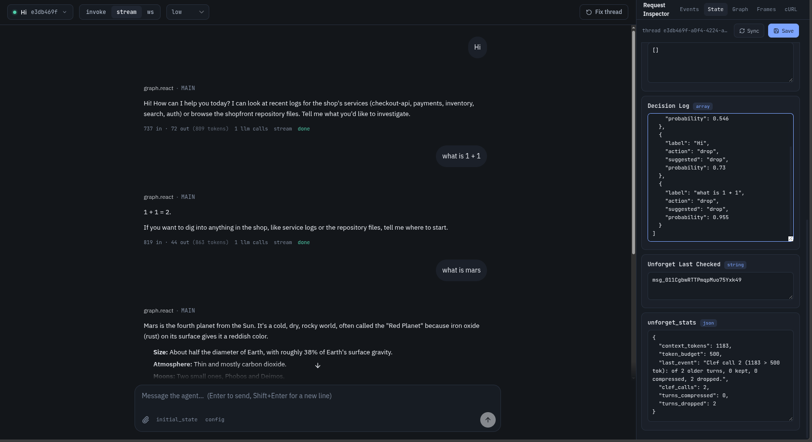
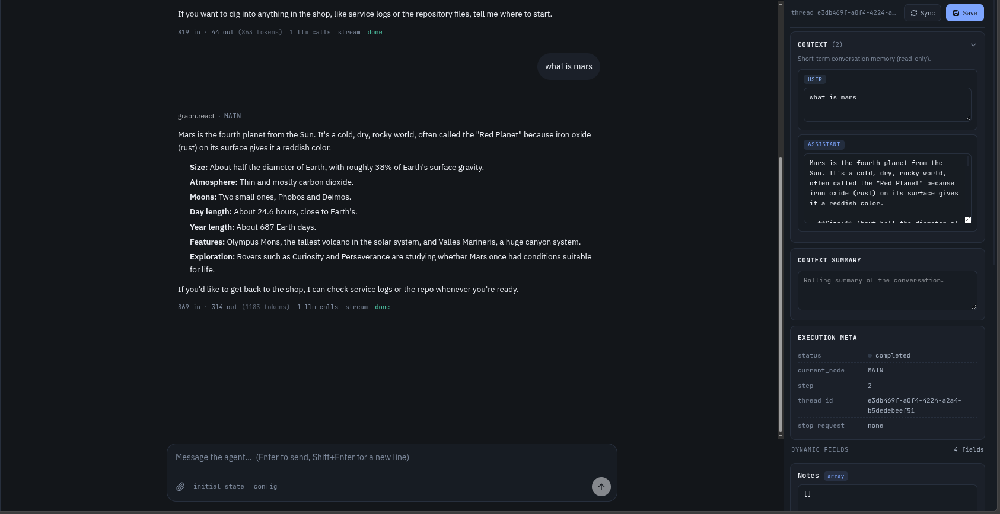
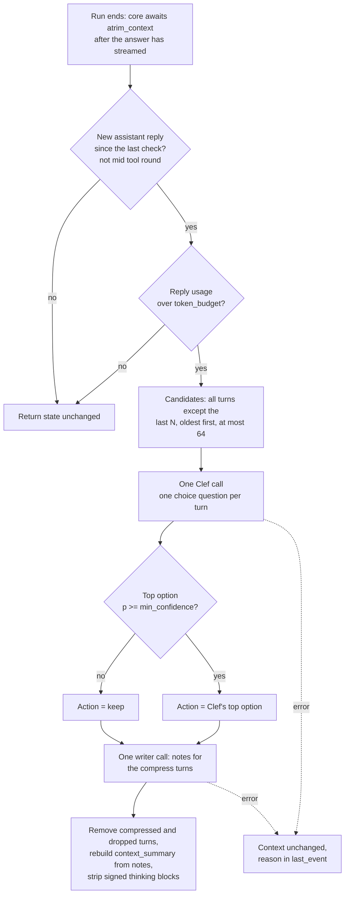

# context-triage

Context triage for LLM agents: a small decision model looks at each old turn and decides to keep, compress or drop it.

**Status:** It is a showcase of one idea built on 10xGraph. The Python package inside is still named `unforget`, its working name. It has had one live smoke test (2026-11-01) with a deliberately tiny token budget: the `drop` path worked. The `compress` path, which calls the note writer, has not been seen in a live run yet. There are no benchmarks.

## The idea

When an agent's chat gets long, the usual fix is one big LLM summary of everything that came before. That rewrites all old context at once, loses detail you cannot get back, and costs a call to your main model.

context-triage does something different. Once the last reply shows the conversation is over a token budget, it groups the history into turns and asks a small dedicated decision model, Cloudflare Clef running on Workers AI, one question per old turn: what should happen to this turn?

- `keep`: leave it as it is.
- `compress`: replace it with a 1 to 3 sentence note.
- `drop`: remove it. Greetings and small talk.

Clef does not write text. For a choice question it returns a probability for every option plus a confidence. That makes each decision cheap, comparable and easy to audit, and lets context-triage ignore any decision the model is not sure about: below `min_confidence` the turn is kept.

There is no archive and no recall tool. The checkpointer already stores the thread's full message history, so the user still sees every message. Only `state.context`, the copy sent to the model, shrinks.

## What it looks like

A live run with a 500-token budget and one protected turn. The thread has three exchanges: "Hi", "what is 1 + 1" and "what is mars".



The State tab shows `decision_log`: "Hi" and "what is 1 + 1" were both dropped, with Clef suggesting `drop` at probability 0.73 and 0.955. An earlier entry for "Hi" has probability 0.546, below the 0.7 gate, so that turn was kept on the first check and offered again on the next one. `unforget_stats` reads `context_tokens` 1183, `token_budget` 500, `clef_calls` 2, `turns_dropped` 2, and `last_event` "Clef call 2 (1183 > 500 tok): of 2 older turns, 0 kept, 0 compressed, 2 dropped."



The chat still shows all three exchanges, while `CONTEXT` in the State tab holds only 2 messages (the "what is mars" user message and its reply). The context summary is empty because nothing was compressed. The last reply's footer reads "869 in · 314 out (1183 tokens)", the same 1183 as `context_tokens`.

## What the user sees vs what the model sees

context-triage edits only `state.context`, the working copy that is sent to the LLM. The thread's message history, which the user and the playground chat show, is stored separately by the checkpointer and is never changed. The newest `keep_recent_turns` turns are never candidates.

Example: a medical assistant. The user asks for a poem and the bot refuses ("I only handle medical questions"). The user sees the refusal. Several turns later the context is over budget and Clef may `drop` that exchange from the model's context, because it is chatter with nothing worth reusing. The model no longer carries it, but the user can still scroll up and see it in the thread.

## How it differs from existing approaches

- One-shot summaries (for example the auto-compact in Claude Code) rewrite the whole history in one pass.
- Observation masking hides old tool output with a fixed rule. It is cheap but does not look at content.
- LLM-ranked condensers (for example OpenHands' attention condenser) keep the top N events and drop the rest, with no reasons.
- Memory stores such as Mem0 and Zep keep facts outside the live context.

context-triage makes a separate decision per turn with a cheap model that is not the main model, needs no training, and returns probabilities that are logged. It does not claim to be first, it has not been measured against any of the above, and unlike some of them it keeps no way to read back what it removed (the thread history aside).

## How it works, step by step



1. **When it runs.** `graph/agent.py` sets `trim_context=False`, so the manager is not called before each LLM call. Core's `sync_data(trim=True)` awaits `atrim_context` once at the end of every run, after the answer has streamed and before the final END event. If someone enables `trim_context`, a tool-round guard skips trimming while the last message is a tool result or an unanswered tool call. A check runs at most once per new assistant reply: `unforget_last_checked` holds that reply's `message_id`.
2. **Size.** The manager takes the latest assistant reply's real usage: prompt tokens plus completion tokens. For Anthropic it also adds cache read and cache write tokens, because Anthropic's `input_tokens` exclude cache (OpenAI and Google already include it). This counts the system prompt and tool definitions, so for a one-call run it matches the playground footer. There are no character estimates. At or under `token_budget` nothing happens.
3. **Turns and candidates.** A turn is a user message and everything that answered it, so a tool call is never separated from its result and user/assistant alternation stays valid. Messages before the first user message are never touched, and system messages are skipped. Candidates are all turns except the last `keep_recent_turns`, oldest first, at most 64 (Clef's limit per call).
4. **One Clef call.** One `choice` question per turn with the options `keep`, `compress` and `drop`, each with a short criterion. The `state` sent to Clef is the task text, the latest user message (clipped to 400 characters) and each turn rendered as text and clipped to `clef_chars_per_turn`, keeping the head and the tail. Below `min_confidence` the action becomes `keep`.
5. **One writer call.** All turns whose action is `compress` go to one batched call to `writer_model` (`claude-haiku-5-5`) through the Anthropic SDK directly (see known issues for why). It returns a 1 to 3 sentence note per turn. If the writer skips a turn, that turn is kept. If the writer call fails, nothing is applied.
6. **Apply.** Compressed and dropped turns are removed from `state.context`. Notes are appended to `notes`, and `context_summary` is rebuilt from all notes. Each decision is added to `decision_log` (the last 100 are kept). After any change, signed or redacted thinking blocks are stripped from the remaining messages: Claude binds a thinking block's signature to the whole prefix before it, and keeping them after removing turns produced a live 400 "Invalid signature in thinking block".
7. **Failures.** Any Clef or writer failure, or missing Cloudflare credentials, leaves the context unchanged and writes the reason to `unforget_stats.last_event`.

10xGraph's `convert_messages` puts `context_summary` in the prompt as an assistant message right after the system prompts. In `graph/agent.py` the system prompt list ends with a user-role "Today Date is ..." entry so the first non-system message is a user message when the summary is present (see known issues).

## Module map

**`unforget/`**

- `manager.py`: `UnforgetContextManager`, a subclass of 10xGraph's `BaseContextManager`. The whole pipeline: due check, candidates, Clef call, confidence gate, writer call, applying decisions, thinking-block stripping, failure handling.
- `clef.py`: `ClefClient`, a small async httpx client for the Cloudflare REST endpoint, plus response parsing.
- `turns.py`: turn grouping, plain-text rendering of a turn, head-and-tail `clip`, and the one-line label (first words of the user message).
- `writer.py`: the one batched note-writing call (`write_notes`) and `make_call_llm`, which calls the Anthropic SDK.
- `models.py`: `UnforgetState` (a subclass of 10xGraph's `AgentState`) and the models stored on it: `Note`, `Decision`, `UnforgetStats`.
- `__init__.py`: exports the public names.

**`graph/`**

- `agent.py`: wires a `ReactAgent` with `claude-sonnet-5-5`, the two tools, `trim_context=False`, the context manager with smoke-test values, and a `SqliteCheckpointer` writing to `unforget.db`.
- `state.py`: `UnforgetDemoState(UnforgetState)`, the graph state.
- `tools.py`: two demo tools, `read_service_log` and `list_project_files`, returning deterministic fake data for a shop called "shopfront". They exist to produce long tool output worth compressing.

**Root:** `10xgraph.json` (agent `graph.agent:app`, env file `.env`, no auth, AG-UI and WebSocket disabled, and `graph.agent:container` for InjectQ), `sync.sh` (builds the venv), `.env.example`, `pyproject.toml`, `NOTES.md` (design notes).

## Configuration

Constructor arguments of `UnforgetContextManager` (all keyword-only):

| Argument | Default | Used in `graph/agent.py` | Meaning |
|---|---|---|---|
| `token_budget` | 8000 | 500 | Check only when the latest reply's prompt plus completion exceeds this. |
| `keep_recent_turns` | 4 (minimum 1) | 1 | Newest turns never offered to Clef. |
| `min_confidence` | 0.7 | 0.7 | Apply the top option only at or above this probability, otherwise keep. |
| `clef_model` | `"clef"` | `"clef"` | The only model the REST endpoint accepts. |
| `writer_model` | `"claude-haiku-5-5"` | `"claude-haiku-5-5"` | Model that writes the compress notes. |
| `clef_client` | `ClefClient()` | default | Swap in a fake for tests. |
| `llm` | Anthropic SDK call with `writer_model` | default | Replaces the writer call: `async (system_prompt, prompt) -> str`. |
| `clef_chars_per_turn` | 800 | default | Turn text clipped to this for Clef. |
| `writer_chars_per_turn` | 6000 | default | Turn text clipped to this for the writer. |

The values in `graph/agent.py` (500 and 1) are smoke-test values so that even "hi" triggers a check. For a longer demo use about 6000 and 4. Real use would want a much larger budget.

## State fields

All live on `UnforgetState` and are persisted with the thread.

| Field | What it holds |
|---|---|
| `context` | The messages the model still sees. It shrinks after a trim. |
| `context_summary` | The rendered block of notes ("Notes on earlier turns of this conversation, oldest first:"), or empty. |
| `notes` | One entry per compressed turn: `label`, `text`. |
| `decision_log` | One entry per decided turn: `label`, `action` (what was applied), `suggested` (Clef's top choice), `probability`. The last 100 are kept. |
| `unforget_last_checked` | The `message_id` of the last assistant reply that was checked. |
| `unforget_stats` | `context_tokens`, `token_budget`, `last_event`, `clef_calls`, `turns_compressed`, `turns_dropped`. |

## Run it

Requirements: Python 3.12 or newer (`sync.sh` creates a 3.13 venv), `uv`, a Cloudflare account, an Anthropic API key.

1. Clone this repo (`context-triage`) and work from its folder. `sync.sh` installs 10xGraph from sibling checkouts, so `../agentflow` (core) and `../agentflow-api` must exist next to the repo folder. Then build the environment:

   ```bash
   cd context-triage
   ./sync.sh
   ```

   This installs 10xGraph from `../agentflow` and `../agentflow-api` in editable mode, plus this project (the `unforget` package). `./sync.sh --clean` deletes `.venv` and rebuilds it. Once 10xGraph is published at the version `pyproject.toml` asks for (`10xgraph[anthropic,sqlite_checkpoint]>=1.0.0rc4` and `10xgraph-api>=1.0.0rc4`), a plain `pip install` of the dependencies in `pyproject.toml` is enough.

2. Configure credentials:

   ```bash
   cp .env.example .env
   ```

   Fill in three variables:

   - `CLOUDFLARE_ACCOUNT_ID`
   - `CLOUDFLARE_API_TOKEN`: the token needs the "Workers AI: Read" permission (or a broader Workers AI scope) on that account.
   - `ANTHROPIC_API_KEY`: used by the main agent (`claude-sonnet-5-5`) and the note writer (`claude-haiku-5-5`).

3. Start the dev server and playground:

   ```bash
   .venv/bin/10xgraph dev
   ```

   `10xgraph dev` opens the playground in your browser.

Threads are stored in `unforget.db` next to the project. Delete it to start over. Threads saved by the older design (which had an archive and a fact ledger) still load, but start a new thread. Without the Cloudflare pair the agent still works, it just never trims.

## Try it

**Quick smoke test** (the shipped 500-token budget and 1 protected turn). Send these one at a time:

1. `hi`
2. `what is 1 + 1`
3. `what is mars`

Open the State tab and press Sync. Small talk like the first two is the kind of turn Clef is likely to suggest `drop` for, as in the screenshots above, but the decisions are Clef's and a turn below the 0.7 gate is kept and offered again on the next check.

**Longer script.** Set `token_budget=6000` and `keep_recent_turns=4` in `graph/agent.py` first. The demo tools return fake data, so none of this touches a real system. Services are `checkout-api`, `payments`, `inventory`, `search`, `auth`. `read_service_log` returns 10 to 80 lines of timestamped INFO, WARN and ERROR entries. `list_project_files` lists a fake `shopfront/` repo. Send these one at a time:

1. `Hi! Thanks for helping today.` (small talk, a likely `drop`)
2. `Please read the last 80 lines of the checkout-api log.` (large tool output, a likely `compress`)
3. `We use MySQL for the orders database, and I prefer short bullet-list answers.` (preferences, a likely `compress`)
4. `Now show me the payments log, 80 lines.`
5. `List the files under src/shopfront/routes.`
6. `Thanks, that helps. What is the weather like for a Friday deploy?` (chatter)
7. `Actually, we switched to Postgres for orders.`
8. `Show me the inventory log and the search log.`
9. `Show me the auth log, 80 lines.`

The first check should happen once a reply reports more than 6000 tokens, and only turns older than the last four can be decided. The expected actions above are likely, not guaranteed: this script is a prompt for exploring, and the compress path has not been confirmed in a live run.

## Where to watch decisions

In the playground, open the Inspector, pick the **State** tab, and press **Sync** after a reply (it fetches `GET /v1/threads/{id}/state`). The Threads page shows the same state as raw JSON. The server also logs one line per trim and one per failure under the `unforget` logger. The fields are listed under "State fields" above. `unforget_stats.last_event` is the quickest read: it says how many turns were kept, compressed and dropped, or why nothing happened.

## Pros and cons

Pros:

- The decision step is cheap and inspectable: every decision is logged with Clef's suggestion and probability.
- The main model is never asked to summarize itself.
- Whole-turn removal keeps message structure valid for providers.
- Low-confidence decisions fall back to `keep`.
- Any failure leaves the context as it was.
- The user's view of the thread is never changed.

Cons and limitations:

- **It is an unmeasured proof of concept.** There are no benchmark numbers, no savings figures and no accuracy claims. Whether it beats a plain summary on your workload is unknown.
- **Compressed notes are lossy and dropped turns are gone from the model's context for good.** There is no archive and no recall tool. The thread history still holds everything, but the model cannot read it back.
- **It trims only at the end of a run.** One long, tool-heavy run is not trimmed mid-run and can grow past the budget until it finishes.
- **Kept turns are asked again.** Turns Clef keeps (or that fall below the gate) are offered again on every over-budget reply, so `decision_log` repeats `keep` entries. Only the oldest 64 older turns are offered per check.
- **A writer failure skips the whole trim**, including the decisions Clef already made.
- **Thinking is stripped.** After a trim, signed and redacted thinking blocks are removed from the remaining messages, so Claude loses its earlier reasoning blocks.
- **Provider prompt caching.** Editing old context changes the prompt prefix and invalidates cached prefixes. context-triage does not model this cost.
- **Clef's choice quality on this task is untested.** Clef is a general decision model; nobody has checked how often it picks sensibly here. Each turn is clipped to 800 characters for Clef, so it decides from the head and tail of long turns only.
- **A second provider.** Cloudflare is an extra account in your setup, and `compress` still costs writer-model tokens.

## Known issues in 10xGraph found while building this

Not fixed in the framework:

1. Core's `call_llm` forwards `temperature` to Anthropic unless the model is in `ANTHROPIC_NO_SAMPLING_MODELS`, which does not include the Claude 5.5 models used here. In the installed Anthropic SDK (1.17.0) `messages.create` has no `temperature` parameter, so the call raises `TypeError: AsyncMessages.create() got an unexpected keyword argument 'temperature'`. The writer therefore calls the Anthropic SDK directly instead of `call_llm`.
2. `convert_messages` injects `context_summary` as an assistant message right after the system prompts. With Anthropic, if no user message precedes it, the first message is an assistant turn. Not verified live; `graph/agent.py` works around it with the user-role date entry.
3. `sync_data` passes the original state, not its deep copy, to `atrim_context`, so the copy is wasted and the trim mutates the live state. Harmless for context-triage.

## Using Postgres instead of SQLite

The project uses `SqliteCheckpointer` in `graph/agent.py`. 10xGraph also ships `PgCheckpointer` (extra: `pg_checkpoint`), exported from `tenxgraph.storage.checkpointer`. It stores durable state in Postgres and caches in Redis, and its constructor needs both a Postgres connection (`postgres_dsn` or an existing `pg_pool`) and a Redis one (`redis_url`, `redis` or `redis_pool`). The change is to install the extra and replace the checkpointer line, roughly:

```python
from tenxgraph.storage.checkpointer import PgCheckpointer

checkpointer = PgCheckpointer(postgres_dsn="postgresql://...", redis_url="redis://...")
```

Schema setup and the other options are in the 10xGraph docs at https://10xgraph.com. This project has not been run with Postgres.

## Clef facts

- Endpoint: `POST https://api.cloudflare.com/client/v4/accounts/{account_id}/ai/run/@cf/cloudflare/clef` with a Bearer token.
- Models: `clef`. The REST endpoint accepts only `clef`; `clef-flash` returned HTTP 422 Unsupported model in a live call.
- Input: a `state` (text or JSON) plus 1 to 64 typed questions. Types: `noul` (yes/no), `choice`, `score`. context-triage uses only `choice`.
- A `choice` answer returns `choice`, `probabilities` and `confidence`.
- Context: 65,536 tokens.
- Price: $0.24 per million input tokens, no output charge.
- Open weights under Apache-2.0 on Hugging Face (`Cloudflare/clef`).
- Docs: https://developers.cloudflare.com/workers-ai/models/clef/

## License

MIT, as declared in `pyproject.toml`. There is no separate `LICENSE` file in the folder yet.
