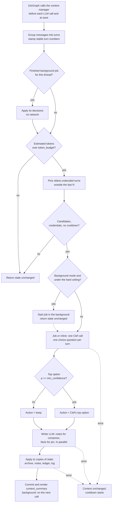

# context-triage

Context triage for LLM agents: a small decision model looks at each old turn and decides to keep, compress, archive, drop or pin it. Everything except a dropped turn can be read back later.

**Status:** proof of concept. Not a library, not on PyPI, not benchmarked. It is a showcase of one idea built on 10xGraph. The Python package inside is still named `unforget`, its working name.

## The idea

When an agent's chat gets long, the usual fix is one big LLM summary of everything that came before. That rewrites all old context at once, loses detail you cannot get back, and costs a call to your main model.

context-triage does something different. Once the conversation passes a token budget, it groups the history into turns and asks a small dedicated decision model, Cloudflare Clef running on Workers AI, one question per old turn: what should happen to this turn?

- `keep`: leave it as it is.
- `compress`: replace it with a 1 to 3 sentence note. The full turn is archived.
- `archive`: remove it from the live context and store it verbatim. The model sees a one-line label and can call a `recall` tool to read it.
- `drop`: remove it. Greetings and small talk. Not stored in the archive.
- `pin`: extract durable facts (preferences, decisions, constraints) into a ledger that stays in the context. The full turn is archived.

Clef does not write text. For a choice question it returns a probability for every option plus a confidence. That makes each decision cheap, comparable and easy to audit, and lets context-triage ignore any decision the model is not sure about.

## What the user sees vs what the model sees

context-triage edits only `state.context`, the working copy that is sent to the LLM. The thread's message history, which the user and the playground chat show, is stored separately by the checkpointer and is never changed. The newest `keep_recent_turns` turns are never candidates, so the user always sees every reply as it arrives.

Example: a medical assistant. The user asks for a poem and the bot refuses ("I only handle medical questions"). The user sees the refusal. Several turns later the context is over budget and Clef may `drop` that exchange from the model's working copy, because it is chatter with nothing worth reusing. The model no longer carries it, but the user can still scroll up and see it in the thread.

## How it differs from existing approaches

- One-shot summaries (for example the auto-compact in Claude Code) rewrite the whole history in one pass and are not reversible.
- Observation masking hides old tool output with a fixed rule. It is cheap but does not look at content.
- LLM-ranked condensers (for example OpenHands' attention condenser) keep the top N events and drop the rest, with no reasons and no way back.
- Memory stores such as Mem0 and Zep keep facts outside the live context. context-triage updates facts inside it.

context-triage combines per-turn actions, a cheap non-main-model decider with no training, a restorable archive and fact updates in the live window. It does not claim to be first, and it has not been measured against any of the above.

## Pipeline, step by step



### 1. When it runs

The agent is a `ReactAgent` created with `trim_context=True` and `context_manager=UnforgetContextManager(...)`, so 10xGraph asks the manager to trim the state's `context`. Core awaits `atrim_context` before every LLM call and again when it saves the state (at run end, on error, and on stop or interrupt). In background mode these calls return without waiting for Clef or the writer (see step 2). The manager does nothing until its estimate of the context exceeds `token_budget`. The estimate is about 4 characters per token, over the messages plus the current `context_summary` block, so the summary's own growth counts.

### 2. Background mode (default)

With `background=True` the user's request never waits for the decision model. A call to `atrim_context` does one of these things:

1. If a job for this thread has finished, apply its decisions now. This is synchronous and uses no network.
2. Otherwise, if the context is over `token_budget` and no job is running for the thread, copy the picked turns, the latest user message and the current facts, start the Clef and writer calls as a task in 10xGraph's `BackgroundTaskManager`, and return the state unchanged.
3. If a job is already running, only update `stats.last_event` and return.

The next call applies the result: the next LLM call in the same run, or the next save. So a trim takes effect one or two calls after it was started.

- **Job key.** Jobs are keyed by `state.execution_meta.thread_id`, one per thread. Without a thread id, without a task manager, or through the sync `trim_context`, the trim runs inline.
- **Task manager lookup.** The run's `current_task_manager` first, then the InjectQ container, but only if a `BackgroundTaskManager` is bound there.
- **Stale results.** Decisions are keyed by stable turn number and applied to the turns as they are in the context at pickup time (the original messages are archived and removed). Turns that left the context or were decided meanwhile are skipped. Turns added after the snapshot are never touched.
- **Hard ceiling.** Past `hard_budget_ratio * token_budget` (2.0 times the budget) a call waits for the thread's running job and applies it, or trims inline if none is running. This stops one long run from growing the context without bound.
- **Who waits.** Core drains background tasks only for sync `invoke()` and on graph `aclose()`. Async runs from the API server (`10xgraph dev`) do not wait for the job, so the response is not delayed.
- **Process memory.** Results live in the server process: they are lost on restart (the turns are asked again) and are not shared across workers. A finished job nobody picks up within 10 minutes is dropped, and at most 256 jobs are held.

`background=False` restores fully inline behavior: every trim awaits Clef and the writer inside the call.

### 3. Turns and stable numbers

A turn is one user message through the final assistant reply, including every tool call and tool result in between (`spans.group_turns`). System messages are skipped. Messages before the first user message form a "preamble" turn that is never a candidate.

Because whole turns are removed, user/assistant alternation stays valid and a tool call is never separated from its result.

Each turn gets a stable number the first time context-triage sees it, written to its first message's `metadata["unforget_turn"]`. The number survives checkpointing and does not shift when earlier turns are removed.

### 4. Which turns are candidates

Candidates are the oldest turns that:

- are not in the last `keep_recent_turns` turns (the newest turn may still be in progress), and
- are not already in `state.decided_turns`.

The manager adds them oldest first until removing them would bring the estimate down to `target_ratio * token_budget`, or until `max_questions` (64) is reached.

### 5. One batched Clef call

All candidates go in one request. The `state` sent to Clef contains:

- a task description,
- the budget numbers (estimated tokens, budget, target),
- the latest user message (clipped to 400 characters),
- the current facts from the ledger,
- per candidate turn: id, turn number, role sequence (for example `user > assistant > tool > assistant`), token estimate, whether it has tool output, tool names, and the turn text clipped to `clef_chars_per_turn` (800) characters, keeping the head and the tail.

Each turn becomes one `choice` question with five options (`keep`, `compress`, `archive`, `drop`, `pin`), each described in a sentence. The text is clipped, so a huge tool output does not hit Clef's 65,536-token context: 64 turns at 800 characters is far below it.

### 6. The confidence gate

For each answer, the probability of the top option is compared with `min_confidence` (0.7). At or above it, the action is applied. Below it, the turn is kept. The full probability table is recorded either way, so you can see "Clef leaned archive at 0.55, kept".

### 7. What each action does

| Action | Live context | State |
|---|---|---|
| `keep` | unchanged | turn marked decided |
| `drop` | turn removed | decision logged, nothing archived |
| `archive` | turn removed | messages stored verbatim in `archive[id]` with a label (first user words, tool names, token count) |
| `compress` | turn removed | writer note added to `notes`, messages stored in `archive[id]` |
| `pin` | turn removed | writer-extracted facts added to `ledger`, messages stored in `archive[id]` |

If the writer returns no note for a `compress` turn, that turn is archived instead.

A `pin` turn is removed from the context even if the writer finds no durable facts in it. In that case it is still archived and the log reason says "no durable facts found".

### 8. The writer LLM

`compress` and `pin` need text written by a model, so context-triage makes one call for all `compress` turns and one for all `pin` turns, run concurrently, using `writer_model` (default and demo value: `claude-haiku-5-5`) through 10xGraph's `call_llm`. Each turn is clipped to `writer_chars_per_turn` (6000) characters. The replies are JSON: `{"notes": [...]}` and `{"facts": [...]}`. Archived content itself is always the original messages, never the clipped or written text.

### 9. Fact supersession

The pin prompt gets the current ledger. If a new fact updates or contradicts an existing one, the writer lists the old key under `replaces` (or reuses the same key). context-triage then marks the old fact `superseded` and sets `superseded_by_turn`. It is never deleted. Only facts with status `current` are rendered into the summary and sent to Clef, so "we use MySQL" followed later by "we switched to Postgres" leaves one current fact and one superseded record.

### 10. What the model sees

`render.render_summary` builds one text block in `state.context_summary`, with up to three sections:

1. Current facts (key, value, turn).
2. Notes on earlier turns, oldest first, each pointing at its archive id.
3. An index of archived turns (`#id: turn N, label`) with an instruction to call `recall(archive_id)` when a detail matters.

10xGraph's `convert_messages` puts `context_summary` in the prompt as an assistant message right after the system prompts and before the kept messages. In `graph/agent.py` the system prompt list ends with a user-role "Today Date is ..." entry so the first non-system message is a user message when the summary is present (see "Known issues").

### 11. The `recall` tool

`recall(archive_id)` looks the id up in `state.archive` and returns the archived turn as readable text (user lines, assistant lines, tool calls, tool results), with its turn number, label and the action that archived it. It does not re-insert the messages into the context and does not modify the archive. An unknown id returns the list of available ids.

### 12. Hysteresis

Every turn Clef decides on, including those it said `keep` for or that the gate held back, is added to `decided_turns` and is never sent to Clef again. This stops a kept turn from being re-asked on every trim. If the context is still over budget and every older turn is decided, the manager logs that once and does nothing.

### 13. Failure behavior

- Clef error, unusable Clef reply, writer error or an exception while applying: the context is left unchanged, a warning is logged, and trimming is skipped for `failure_cooldown` seconds (60), so an outage does not add a timeout to every model call. If the writer fails, the whole trim is abandoned, including Clef's decisions for that batch; those turns are asked again after the cooldown.
- Background job failure: the error is recorded on the job and handled when the next call picks it up, the same way as an inline failure. The context is unchanged, the cooldown starts and `background_jobs_failed` goes up.
- Background job timeout: a job that takes longer than `job_timeout` (120 seconds) counts as a failure, with the cooldown.
- Background job cancelled (10xGraph's `aclose` can cancel leftover tasks): the job is discarded at pickup with no cooldown, and `background_jobs_discarded` goes up. Its turns are asked again.
- Backpressure: if the task manager drops the new task, the trim is skipped this time with no cooldown and tried again on a later call. The same happens when 256 jobs are already in flight.
- Stale job: if every decided turn has left the context or was decided meanwhile, the result is discarded.
- Decisions are applied to copies of the state fields and committed together at the end, so a failure mid-apply cannot leave half-written state.
- Missing `CLOUDFLARE_ACCOUNT_ID` or `CLOUDFLARE_API_TOKEN`: one warning, `last_event` says credentials are missing, context unchanged. Credentials are read at call time, so the graph imports without any keys.
- A state that does not subclass `UnforgetState` gets a one-time warning and is returned unchanged.

### 14. Stats

`unforget_stats` keeps `token_budget`, `context_tokens` (latest estimate, summary included), `clef_calls`, `clef_input_tokens` (from Clef's `usage`), `turns_decided`, `tokens_freed`, `last_tokens_before`, `last_tokens_after` and `last_event` (a human-readable sentence about the latest trim). In background mode it also counts jobs: `background_jobs_started`, `background_jobs_applied`, `background_jobs_failed` (Clef, writer or timeout, with cooldown) and `background_jobs_discarded` (cancelled, or every turn left the context before pickup).

## Module map

**`unforget/`**

- `manager.py`: `UnforgetContextManager`, a subclass of 10xGraph's `BaseContextManager`. Holds the whole pipeline: trigger, batch selection, Clef call, confidence gate, writer calls, applying decisions, failure handling, and the background jobs (start, pickup, hard ceiling, leak guard).
- `clef.py`: `ClefClient`, a small async httpx client for the Cloudflare REST endpoint, plus `parse_response`. Validates answers, rejects options that were not offered, and accepts both a bare `{"answers": ...}` body and Cloudflare's `{"result": ...}` envelope.
- `writer.py`: the cheap-LLM step. Prompts, JSON parsing (tolerates code fences), `write_notes` and `extract_facts`, and `make_call_llm`, which wraps 10xGraph's `call_llm`.
- `spans.py`: turn grouping, stable numbering, token estimates, plain-text rendering of a turn, head-and-tail `clip`, and the one-line archive label.
- `render.py`: builds the `context_summary` text from the ledger, notes and archive.
- `recall.py`: the `recall` tool.
- `models.py`: `UnforgetState` (a subclass of 10xGraph's `AgentState`) and the models stored on it: `Fact`, `Note`, `ArchivedTurn`, `Decision`, `UnforgetStats`.
- `__init__.py`: exports the public names.

**`graph/`**

- `agent.py`: wires a `ReactAgent` with `claude-sonnet-5-5`, the three tools, `trim_context=True`, the context manager with demo values, and a `SqliteCheckpointer` writing to `unforget.db`.
- `state.py`: `UnforgetDemoState(UnforgetState)`, the graph state.
- `tools.py`: two demo tools, `read_service_log` and `list_project_files`, returning deterministic fake data for a shop called "shopfront". They exist to produce long tool output worth archiving.

**Root:** `10xgraph.json` (agent `graph.agent:app`, env file `.env`, no auth, AG-UI and WebSocket disabled, and `graph.agent:container` for InjectQ), `sync.sh` (builds the venv), `.env.example`, `pyproject.toml`, `NOTES.md` (design notes and Clef facts).

## Configuration

Constructor arguments of `UnforgetContextManager` (all keyword-only):

| Argument | Default | Used in `graph/agent.py` | Meaning |
|---|---|---|---|
| `token_budget` | 8000 | 3000 | Trim only when the estimate exceeds this. |
| `target_ratio` | 0.6 | 0.6 | A trim aims for `target_ratio * token_budget`. |
| `keep_recent_turns` | 4 (minimum 1) | 4 | Newest turns never offered to Clef. |
| `min_confidence` | 0.7 | 0.7 | Apply the top option only at or above this probability. |
| `clef_model` | `"clef"` | `"clef"` | The only model the REST endpoint accepts. |
| `writer_model` | `"claude-haiku-5-5"` | `"claude-haiku-5-5"` | Model for compress notes and pinned facts. |
| `clef_client` | `ClefClient()` | default | Swap in a fake for tests. |
| `llm` | `call_llm` with `writer_model` | default | Replaces the writer call: `async (system_prompt, prompt) -> str`. |
| `max_questions` | 64 | default | Turns per Clef call (1 to 64). |
| `clef_chars_per_turn` | 800 | default | Turn text clipped to this for Clef. |
| `writer_chars_per_turn` | 6000 | default | Turn text clipped to this for the writer. |
| `failure_cooldown` | 60.0 | default | Seconds to skip trimming after a failure. |
| `recall_tool_name` | `"recall"` | default | Tool name the summary tells the model to call. |
| `background` | `True` | `False` (off for the first live test) | Run Clef and the writer as a background task and apply the result on the next call. `False` awaits them inside the trim. |
| `hard_budget_ratio` | 2.0 (must be greater than 1) | 2.0 | Past `hard_budget_ratio * token_budget` a call waits for the running job, or trims inline. 6000 tokens in the demo. |
| `job_timeout` | 120.0 | default | Seconds a background job may take before it counts as a failure. |

`ClefClient` itself takes `account_id`, `api_token`, `timeout` (default 20 seconds) and `transport`.

The demo uses a 3000-token budget so decisions show up after a handful of turns. Real use would want a much larger one.

## Run it

Requirements: Python 3.12 or newer (`sync.sh` creates a 3.13 venv), `uv`, a Cloudflare account, an Anthropic API key.

1. Clone this repo (`context-triage`) and work from its folder. `sync.sh` installs 10xGraph from sibling checkouts, so `../agentflow` (core) and `../agentflow-api` must exist next to the repo folder. Then build the environment:

   ```bash
   cd context-triage
   ./sync.sh
   ```

   This installs 10xGraph from `../agentflow` and `../agentflow-api` in editable mode, plus this project (the `unforget` package). It exists because the project was built against a local 10xGraph checkout. `./sync.sh --clean` deletes `.venv` and rebuilds it from scratch. Once 10xGraph is published at the version `pyproject.toml` asks for (`10xgraph[anthropic,sqlite_checkpoint]>=1.0.0rc4` and `10xgraph-api>=1.0.0rc4`), a plain `pip install` of the dependencies in `pyproject.toml` is enough.

2. Configure credentials:

   ```bash
   cp .env.example .env
   ```

   Fill in three variables:

   - `CLOUDFLARE_ACCOUNT_ID`
   - `CLOUDFLARE_API_TOKEN`: the token needs the "Workers AI: Read" permission (or a broader Workers AI scope) on that account.
   - `ANTHROPIC_API_KEY`: used by the main agent (`claude-sonnet-5-5`) and the writer (`claude-haiku-5-5`).

3. Start the dev server and playground:

   ```bash
   .venv/bin/10xgraph dev
   ```

   `10xgraph dev` opens the playground in your browser.

Threads are stored in `unforget.db` next to the project. Delete it to start over. Without the Cloudflare pair the agent still works, it just never trims.

## Try this conversation

The demo tools return fake data, so none of this touches a real system. Services are `checkout-api`, `payments`, `inventory`, `search`, `auth`. `read_service_log` returns 10 to 80 lines of timestamped INFO, WARN and ERROR entries. `list_project_files` lists a fake `shopfront/` repo. Send these one at a time:

1. `Hi! Thanks for helping today.` (small talk, a `drop` candidate)
2. `Please read the last 80 lines of the checkout-api log.` (large tool output, an `archive` candidate)
3. `We use MySQL for the orders database, and I prefer short bullet-list answers.` (durable facts, a `pin` candidate)
4. `Now show me the payments log, 80 lines.`
5. `List the files under src/shopfront/routes.`
6. `Thanks, that helps. What is the weather like for a Friday deploy?` (chatter)
7. `Actually, we switched to Postgres for orders.` (should supersede the MySQL fact)
8. `Show me the inventory log and the search log.`
9. `Which order id failed card authorization in the checkout-api log you read earlier?` (the model should call `recall` on the archived log)

With a 3000-token budget the first trim should happen somewhere around the third or fourth long tool output, and only turns older than the last four can be decided. The exact decisions are up to Clef; this script is a prompt for exploring, not a guarantee. Nothing here has been checked against a live run yet.

## Where to watch decisions

In the playground, open the Inspector, pick the **State** tab, and press **Sync** after a reply (it fetches `GET /v1/threads/{id}/state`). The Threads page shows the same state as raw JSON. The server also logs one line per decision and one per trim under the `unforget` logger, plus one line when a background job starts and one when it finishes, fails or is cancelled. In background mode decisions show up one reply later than the trim that started them: `last_event` first reads "Clef job started for N turn(s) ...", then "applied background decisions for turns ...".

| Field | What it shows |
|---|---|
| `context` | The messages the model still sees. It shrinks after a trim. |
| `context_summary` | The rendered block: current facts, notes and the archive index. |
| `decision_log` | One entry per decided turn: `turn`, `trim` (the trim count), `suggested` (Clef's top option), `action` (what was applied, `keep` if the gate held it), `probability`, `probabilities` (all five), `applied`, `reason`, `label`, `tokens`, `tokens_freed`, `archive_id`, `background` (true when a background job made the decision). |
| `ledger` | Facts with `key`, `value`, `turn`, `archive_id`, `status` (`current` or `superseded`) and `superseded_by_turn`. |
| `notes` | Compress notes: `turn`, `text`, `archive_id`. |
| `archive` | Archived turns by id: `turn`, `kind` (`archive`, `compress` or `pin`), `label`, `tokens`, and the original `messages`. |
| `decided_turns` | Turn numbers already decided, never sent to Clef again. |
| `unforget_stats` | Counters and the latest trim outcome, including `background_jobs_started`, `background_jobs_applied`, `background_jobs_failed` and `background_jobs_discarded` (see step 14). |

## Why this is interesting

- **Per-turn decisions instead of one rewrite.** Each turn gets its own action. A greeting can go while a log is archived and a preference is pinned.
- **A cheap decider that is not the main model.** Clef is priced at $0.24 per million input tokens with no output charge, and it needs no fine-tuning for this use. The main model is never asked to summarize itself.
- **A confidence per decision.** Probabilities for all five options come back, so low-confidence calls fall back to `keep` instead of destroying context.
- **An audit log.** Every decision records the probabilities, the reason, the tokens freed and the archive id. You can read why a turn disappeared.
- **A restorable archive with a recall tool.** Compressed, archived and pinned turns stay verbatim in state, and the model is told how to get them.
- **Fact updates inside the live context.** Superseded facts are marked, not deleted, and only current facts are shown.
- **Background decisions.** The decision model runs as a background task in 10xGraph and its result is applied on the next call, so the user's request does not wait for it.
- **Fail-safe.** Any Clef, writer or credential problem leaves the context as it was.

## Pros and cons

Pros:

- The decision step is cheap and inspectable.
- The decision model is not in the user's request path: in background mode the user does not wait for Clef or the writer, except over the hard ceiling.
- Whole-turn removal keeps message structure valid for providers.
- Nothing is silently lost except what Clef confidently labels `drop`.
- Runs against any 10xGraph agent that subclasses `UnforgetState`.

Cons and limitations:

- **It is an unmeasured proof of concept.** There are no benchmark numbers here, no savings figures and no accuracy claims. Whether it beats a plain summary on your workload is unknown.
- **`drop` is not archived.** Only `compress`, `archive` and `pin` are stored, so a dropped turn cannot be recalled. Dropped turns leave the model's context only: the checkpointer keeps the thread's message history separately, so they still appear in the thread history, but the `recall` tool cannot reach them. This is why the tagline excludes dropped turns.
- **A second provider and writer cost.** In background mode the user no longer waits for Clef, except when the context passes the hard ceiling (then the call waits for the job or trims inline, with a Clef timeout of 20 seconds). Cloudflare is still an extra account in your setup, and `compress` and `pin` still cost writer-model tokens.
- **The budget is soft.** In background mode the context can stay over `token_budget` for one or two model calls until the job's result lands.
- **Results live in process memory.** They are lost on restart (those turns are asked again) and are not shared across several server workers.
- **Sync `invoke()` still waits.** Core drains background tasks at the end of a sync `invoke()` and on `aclose()`, so that path waits for the job. `aclose` may also cancel a job, which is then discarded.
- **Clef's choice quality on this task is untested.** Clef is a general decision model; nobody has checked how often it picks sensibly here. Questions are capped at 64 per call, and Clef's context is 65,536 tokens, which is why each turn is clipped to 800 characters before it is sent (so Clef decides from the head and tail of long turns only).
- **State grows.** Archived turns are stored in the checkpoint, so the checkpoint can be larger than the live context ever is.
- **Provider prompt caching.** Rewriting old context changes the prompt prefix and can invalidate cached prefixes. context-triage does not model this cost.
- **Rough token estimate.** About 4 characters per token, not a real tokenizer.
- **Writer errors fail the whole trim**, including decisions Clef already made, until the cooldown ends.
- **Open items.** Cloudflare does not document whether the REST reply is wrapped in its usual `{"result": ...}` envelope, so the parser accepts both. The writer passes `temperature=1.0` because newer Claude models appear to reject other sampling values; this is unverified. No test suite, and no live run with real keys yet.

## Known issues in 10xGraph found while building this

Recorded in `NOTES.md`, not fixed in the framework:

1. `call_llm` sends `temperature=0.3` by default unless the model is on an internal no-sampling list, which does not include the Claude 5.5 models used here. The writer overrides it with `1.0`.
2. `convert_messages` injects `context_summary` as an assistant message right after the system prompts. With Anthropic, if no user message precedes it, the first message is an assistant turn. Not verified live; `graph/agent.py` works around it with the user-role date entry.
3. `sync_data` passes the original state, not its deep copy, to `atrim_context`, so the copy is wasted and the trim mutates the live state. Harmless for context-triage.

## Using Postgres instead of SQLite

The project uses `SqliteCheckpointer` in `graph/agent.py`. 10xGraph also ships `PgCheckpointer` (extra: `pg_checkpoint`), exported from `tenxgraph.storage.checkpointer`. It stores durable state in Postgres and caches in Redis, and its constructor needs both a Postgres connection (`postgres_dsn` or an existing `pg_pool`) and a Redis one (`redis_url`, `redis` or `redis_pool`). The change is to install the extra and replace the checkpointer line, roughly:

```python
from tenxgraph.storage.checkpointer import PgCheckpointer

checkpointer = PgCheckpointer(postgres_dsn="postgresql://...", redis_url="redis://...")
```

Schema setup and the other options are in the 10xGraph docs at https://10xgraph.com. This project has not been run with Postgres.

## Clef facts

- Endpoint: `POST https://api.cloudflare.com/client/v4/accounts/{account_id}/ai/run/@cf/cloudflare/clef` with a Bearer token.
- Models: `clef`. The REST endpoint accepts only `clef`; `clef-flash` returned HTTP 422 Unsupported model in a live call.
- Input: a `state` (text or JSON) plus 1 to 64 typed questions. Types: `noul` (yes/no), `choice`, `score`. context-triage uses only `choice`.
- A `choice` answer returns `choice`, `probabilities` and `confidence`.
- Context: 65,536 tokens.
- Price: $0.24 per million input tokens, no output charge.
- Open weights under Apache-2.0 on Hugging Face (`Cloudflare/clef`).
- Docs: https://developers.cloudflare.com/workers-ai/models/clef/

## License

MIT, as declared in `pyproject.toml`. There is no separate `LICENSE` file in the folder yet.
